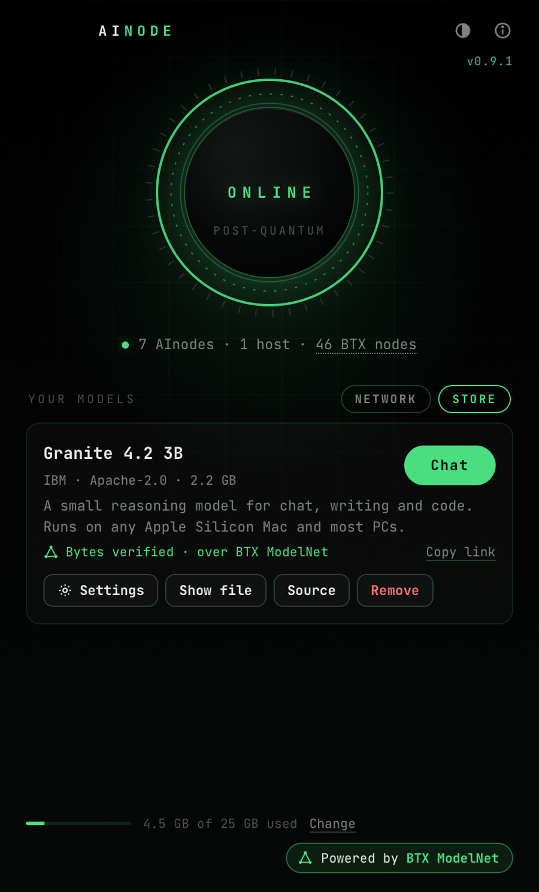
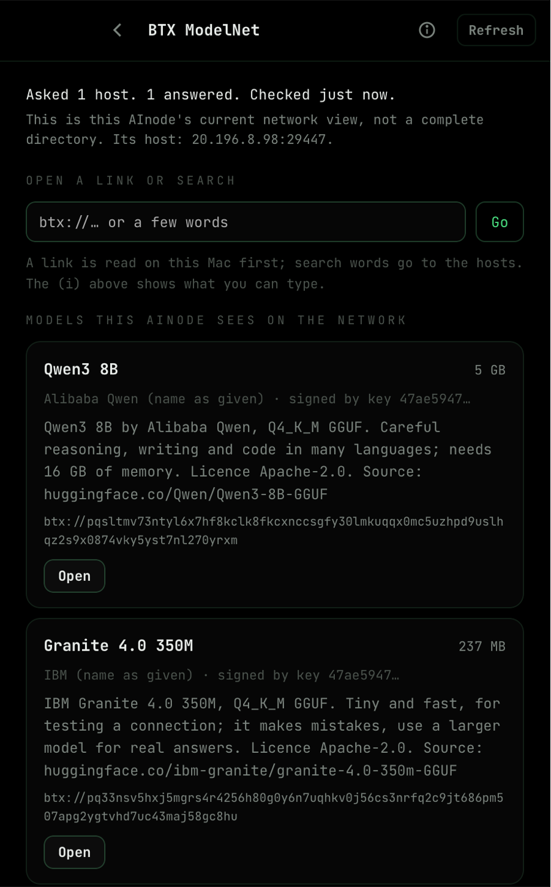

# AInode

**Open AI models, fetched over BTX's model network, checked piece by piece, and run on your own computer.**

AInode is a small desktop app for Mac, Windows and Linux. You pick a model.
AInode fetches it from a host on BTX's model network (ModelNet), checks every
piece against the hash in its link, and runs it on your computer with
llama.cpp. There is no account, no wallet and no node to run. What you type
in a chat never leaves your machine.

[](LICENSE)

<p align="center">
  
  &nbsp;
  
</p>

<p align="center"><sub>Left: the home screen of 0.9.1, drawn from the 0.9.1 interface with sample numbers. Right: the BTX ModelNet view, showing what the public model host answered.</sub></p>

[Download](https://github.com/MendeMatthias/ainode-releases/releases) ·
[easybtx.com/ai](https://easybtx.com/ai) ·
[Direction](docs/DIRECTION.md) ·
[Contributing](CONTRIBUTING.md) ·
[Forking](FORKING.md) ·
[Security](SECURITY.md)

## How it works

1. **You choose how much disk AInode may use.** It writes nothing before you
   answer: no data folder, no web cache in your home folder.
2. **Start.** The app runs upstream's `btx-modeld` with post-quantum TLS
   (ML-KEM-768 key exchange, ML-DSA-44 identities). It never listens on the
   network and never shares what it downloads.
3. **Get.** A model is a content-addressed `btx://` link: the link names the
   exact bytes. The model arrives in 4 MiB pieces, each checked by SHA-384
   before it is kept. The runnable file is checked once more against the
   publisher's sha256.
4. **Chat.** llama.cpp runs the model on your computer, on 127.0.0.1 only,
   behind a key that lives for one session. An offline library (BTX's own
   documentation, and opening paragraphs of 46,941 Wikipedia articles) adds a
   paragraph when it clearly answers the question. Nothing is looked up
   online.

## Built on the BTX vision

[BTX](https://github.com/btxchain/btx) is a chain whose developers are
building a model network beside it: public AI models that anyone can fetch
from any computer that carries them, with every piece checked. Three things
upstream says about it, in its own words:

- The node is the product: "one BTX node that owns both the money and the
  swarm" (an open pull request,
  [btxchain/btx#245](https://github.com/btxchain/btx/pull/245)).
- Fetching a public model is free: "Fetch does not require a wallet"
  (`doc/modelnet/registry-independence.md`).
- Upstream's desktop app is the window onto a node: "Atlas is the interface
  to one BTX node" (`gui/atlas/FEATURE_PARITY.md`).

AInode stands in one place in that picture: it is the door for people who do
not run a node. It runs upstream's own model engine, `btx-modeld`, with the
engine's sources untouched. It follows ModelNet the way upstream ships and
documents it, and it adds nothing to the protocol. Where it holds back from
an upstream default, the reason is written down in
[docs/DIRECTION.md](docs/DIRECTION.md).

AInode is an independent project, built by easyBTX. It is not an official BTX
project, and it is not affiliated with or endorsed by the BTX developers.

What we find while building it, we report upstream. Six fixes went that way
and are in upstream's v0.34.16:

- [#228](https://github.com/btxchain/btx/issues/228): the model network could not start on a stock Mac.
- [#229](https://github.com/btxchain/btx/issues/229): a second host for the same model made downloads fail.
- [#230](https://github.com/btxchain/btx/issues/230): any upload limit made every fetch from that host fail.
- [#231](https://github.com/btxchain/btx/issues/231): on very slow lines, pieces that had arrived in full were thrown away.
- [#232](https://github.com/btxchain/btx/issues/232): a downloaded model could not be deleted, and every model was stored twice.
- [#233](https://github.com/btxchain/btx/issues/233): a macOS source build could not configure.

One report is open: [#946](https://github.com/btxchain/btx/issues/946), about
what a standalone engine does when it has no chain name. The experiments
behind the six are in [docs/experiments.md](docs/experiments.md).

## What you can take from it

AInode is meant as a baseline. These parts stand on their own, and another
app on BTX could reuse them:

- **A reproducible Mac build of upstream's model engine.**
  [`app/scripts/build-engine-macos.sh`](app/scripts/build-engine-macos.sh)
  builds `btx-modeld` from a pinned upstream commit and writes a manifest of
  every input. It gave the same bytes in every run on its pinned toolchain.
- **The life of the engine around `btx-modeld`:** a private socket folder,
  start, stop, an orphan from an earlier run cleaned up, a dead engine
  started again. [`app/src-tauri/src/engine.rs`](app/src-tauri/src/engine.rs),
  [`backend/keeper.rs`](app/src-tauri/src/backend/keeper.rs), and the written
  contract in [`app/ENGINE-CONTRACT.md`](app/ENGINE-CONTRACT.md).
- **One copy of each model on disk,** for an app that does not share:
  [`app/src-tauri/src/store_once.rs`](app/src-tauri/src/store_once.rs).
- **A network view that says only what it knows.** What a client may claim
  about the network and what it must not: "this computer's view", never a
  census; an amount raised only when the engine knows it from the chain.
  [`app/src/netview.ts`](app/src/netview.ts) with its tests.
- **Checks on everything that comes from the network or the user:** hosts,
  links, ids, and what may be copied to the clipboard.
  [`app/src-tauri/src/validate.rs`](app/src-tauri/src/validate.rs),
  [`app/src/safe.ts`](app/src/safe.ts).
- **Signed self-update and release scripts for three platforms.** An update
  is taken only when it is signed under its exact release name.
  [`app/src-tauri/src/update.rs`](app/src-tauri/src/update.rs),
  [`app/scripts/`](app/scripts), [docs/SIGNING.md](docs/SIGNING.md).
- **The Windows path through WSL:** upstream's Linux engine, unmodified, in
  the app's own small WSL distribution.
  [`app/src-tauri/src/wsl.rs`](app/src-tauri/src/wsl.rs),
  [`app/wsl-host/`](app/wsl-host), [docs/windows.md](docs/windows.md).
- **The chat's offline knowledge and its search:** which paragraph answers a
  question, or none. [`app/src/knowledge/`](app/src/knowledge), with the tools
  that build the packs in [`lab/knowledge/`](lab/knowledge).

Some of this may be useful to Atlas, and to other apps that are coming on
BTX. Whether and how is for upstream and those projects to decide. We are
glad to help with either.

## Fork it, build on it

We would like more developers to work on this, and more people to fork it.

AInode is MIT licensed and meant as a starting point. Take it, rename it, and
build your own door into ModelNet. Or stay and make this one better.

- **Forking:** [FORKING.md](FORKING.md) lists what a fork must change so two
  apps do not collide on one computer, and two files a fork may not simply
  keep.
- **Sending changes:** [CONTRIBUTING.md](CONTRIBUTING.md) says what to run and
  what a pull request should contain. Everyone works through pull requests;
  the maintainer reviews and merges.
- **Conduct:** [CODE_OF_CONDUCT.md](CODE_OF_CONDUCT.md).

What is most wanted right now:

- **Windows and Linux on real machines.** Both are built and released, and
  [docs/platforms.md](docs/platforms.md) lists what was never tried: a real
  GPU through Vulkan, Windows 10, a PC without WSL, most Linux distributions.
- **A public guide for running a model host.** Today's host was set up with
  the maintainer's own tooling, which is not in this repository. A clean guide
  that anyone can follow is open work.
- **More hosts and more models.** One public host serves four models. A model
  joins the catalog with its licence record
  ([docs/model-licence.md](docs/model-licence.md)).
- **Translations.** The interface is English only, and its text lives in the
  code. There is no translation layer yet. Building one is welcome.
- **Plain language.** If a screen confused you, that is a bug.

## Download and status

AInode is in beta.

- **Mac** (Apple Silicon, macOS 13 or newer): 0.9.2, signed and notarized.
- **Windows** (11, x64; Windows 10 is untested): 0.9.2. The installer is not
  code-signed yet, so Windows asks before it runs.
- **Linux** (x86_64, `.deb` and AppImage): 0.9.2. It needs glibc 2.39 and the
  C++ library of GCC 14, or newer: [docs/platforms.md](docs/platforms.md).

On Windows and Linux the engine is upstream's own v0.34.16 file, unmodified.

Get it from the
[releases page](https://github.com/MendeMatthias/ainode-releases/releases) or
from [easybtx.com/ai](https://easybtx.com/ai). An installed AInode updates
itself, and takes only an update signed with its own key. What changed in
each version: [docs/](docs) (`release-notes-*.md`).

## Build from source

Everything is run from `app/`. You need Node 20 or newer and stable Rust
(`rust-toolchain.toml` names the toolchain). The 0.9.2 release was built on the Mac with
Node 24.18 and Rust 1.98.1.

```bash
cd app
npm ci
```

**macOS** (Apple Silicon, macOS 13 or newer). Tools: Xcode with its
command-line tools, `cmake`, `ninja`, `jq`.

```bash
scripts/build-engine-macos.sh --from-github --out "$HOME/btx-helper"
AINODE_HELPER_DIR="$HOME/btx-helper" scripts/stage-engine.sh
npx tauri build --bundles app
scripts/check-bundle.sh
```

The first command builds `btx-modeld` from upstream's pinned commit and takes
several minutes. `stage-engine.sh` accepts the result only if its sha256 is
the pinned one. That hash holds for one toolchain, named beside the pin. With
another Xcode or cmake the same source gives other bytes, and the script
stops and says what to do. The app comes out at
`src-tauri/target/release/bundle/macos/AInode.app`, without a Developer ID
signature.

**Linux** (x86_64, glibc 2.39 or newer and GCC 14's libstdc++, as on
Ubuntu 24.04: staging starts the engine once to prove it). Tools: the
[Tauri 2 Linux prerequisites](https://tauri.app/start/prerequisites/), `curl`,
`jq`, `binutils`, `iproute2`, `squashfs-tools`, `dpkg`, `python3`.

```bash
scripts/stage-engine.sh        # upstream's Linux release archive, checked against its pinned sha256
scripts/release-linux.sh       # a .deb and an AppImage in dist-linux/, each checked
```

**Windows** (x64, Windows 11, WSL2). The engine is staged inside a WSL build
distribution, and the app is built with the Windows toolchain:

```powershell
powershell -ExecutionPolicy Bypass -File app\scripts\release-windows.ps1 -BuildDistro <your build distribution>
```

More on each platform: [docs/platforms.md](docs/platforms.md),
[docs/windows.md](docs/windows.md), [docs/SIGNING.md](docs/SIGNING.md).

### Develop and test

```bash
cd app
npm run dev                      # the interface against a mock engine: http://localhost:1450/?mock=fresh
npx tsc --noEmit                 # types
npm test                         # the interface tests
cd src-tauri && cargo test --lib # the Rust unit tests
```

These pass on a fresh clone, without staging the engine. Two interface tests
run `lab/replay-chat.py` with Python 3. The tests under `app/src-tauri/tests/`
need a staged engine and a reachable model host; they are marked `#[ignore]`
and say in their first lines how to run them.

Never run a development build against the folder or the socket of an
installed AInode. The dev bridge and the live tests refuse to.

## Good to know

What the app sends, and to whom:

- **The model host** sees your computer's IP address and the engine's public
  key: when you download, and every 5 seconds while AInode is open (about 350
  MB of traffic over a full day; reported upstream as
  [#946](https://github.com/btxchain/btx/issues/946)).
- **A host you add for searching** sees the same, and the words you search
  for, each time a search runs.
- **easybtx.com** is told every 5 minutes that an AInode is open: a random
  number for the install, the version, the platform, whether the engine runs,
  and how many models and hosts it has. You can turn that off ("Count me").

Your chats and your files go nowhere. The full account, with what was
measured and what was only read, is in [SECURITY.md](SECURITY.md).

What AInode will not become:

1. **A node.** It runs no `btxd` and validates no chain.
2. **A wallet.** It holds no keys for money and moves no funds.
3. **Something that talks to hosts you cannot see in it.** The engine is
   given the model host shown in the app and the hosts you add. One exception
   is the engine's own: during a download, and for up to 15 minutes after it,
   it may contact other sources of that model that the host named.

The reasons, and what is deliberately not built yet, are in
[docs/DIRECTION.md](docs/DIRECTION.md).

## Repository

- [`app/`](app): the app. Tauri 2, Rust, plain TypeScript, one window.
- [`app/scripts/`](app/scripts): staging the engine, building and checking a
  release on each platform, the licence texts that ship.
- [`app/src/knowledge/`](app/src/knowledge): what every model is told, and the
  offline packs.
- [`docs/`](docs): direction, platforms, Windows, signing, the experiments on
  upstream's engine, release notes.
- [`lab/`](lab): tools. The knowledge generators, an RPC client, a fetch
  timer, a WAN emulator, a WebKit snapshotter, the chat replay.
- [`scripts/`](scripts): a check of the pinned engine against upstream's
  latest, and a syntax check of the CI workflows.

### Reading this code

The project was private until November 2026, and its comments were written
for the people building it. A few things point outside this repository:

- `lab/evidence/<date>/...`, `STATUS.md` and `docs/modelnet/...` are the
  maintainer's measurement records and plans. They are not published. Where
  a comment cites one, the number it gives was measured, and the record of
  that run is not here.
- "Mende" is Matthias Mende, the maintainer. Comments name him where a
  behaviour was his decision.
- "Track M" and "Track W" are the Mac and the Windows and Linux build
  machines.
- `host/` held the maintainer's own tooling for the public model host. It is
  not published. The test `app/src/host-catalog.test.ts` checks that tooling
  against the catalog and skips itself when the files are absent.

## Licence and credits

MIT, see [LICENSE](LICENSE). Two of the knowledge files are not MIT:
`app/src/knowledge/wiki.json` is CC BY-SA 4.0 (Wikipedia contributors), and
`app/src/knowledge/pq-wiki.json` is all rights reserved, included with its
author's permission. The MIT licence covers the code, not the AInode or
easyBTX name or logo ([FORKING.md](FORKING.md)).

AInode stands on [BTX](https://github.com/btxchain/btx) and its model
network, [llama.cpp](https://github.com/ggml-org/llama.cpp),
[OpenSSL](https://www.openssl.org/) (inside the engine) and
[Tauri](https://tauri.app/). The models it offers are published by
[IBM](https://huggingface.co/ibm-granite) (Granite),
[Alibaba's Qwen team](https://huggingface.co/Qwen) (Qwen3) and
[OpenAI](https://huggingface.co/openai/gpt-oss-20b) (gpt-oss), each under
Apache-2.0. Versions, sources and licences: [THIRD-PARTY.md](THIRD-PARTY.md).

Not affiliated with or endorsed by IBM, Alibaba, OpenAI or the BTX
developers.
